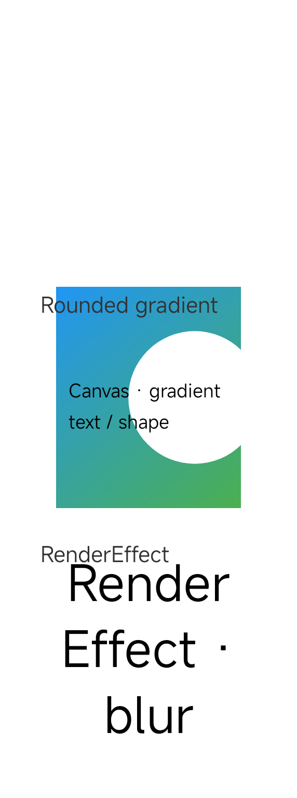
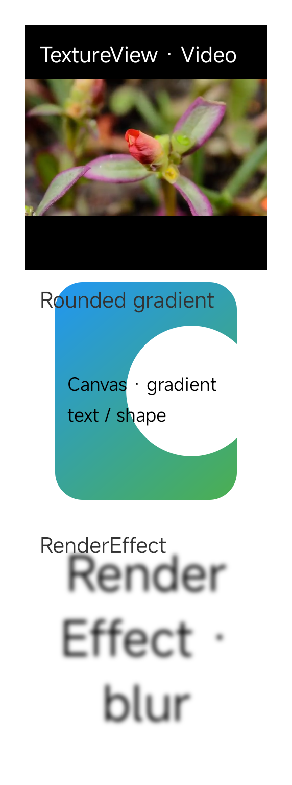
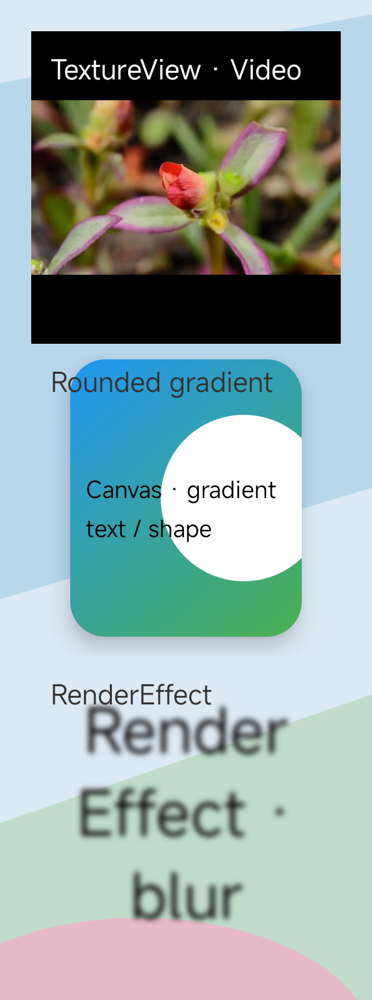

# ViewCapture

一行调用，使用硬件绘制捕获 Android View 的完整内容。

[English](README.md) | **简体中文**

ViewCapture 将 Android View 转换为 Bitmap，适用于内容卡片及超出屏幕的长布局。支持 Android 5.0+（API 21+），Android 8+ 使用硬件绘制。

## 核心能力

- **硬件绘制**：Android 8+ 支持硬件 Canvas 绘制、TextureView 画面及 `HARDWARE` Bitmap 内容。
- **完整内容截图**：默认按原始像素尺寸捕获目标 View 已完成布局的全部范围，包含屏外内容，无需滚动界面。
- **缩放输出**：在绘制时直接缩放，每个硬件分块也按指定比例绘制，减少输出尺寸。
- **保留透明度**：保留目标 View 的透明像素，截图范围限定在目标 View 层级，不截入祖先背景。
- **超高 View 支持**：自动分块绘制并拼接为一张 Bitmap，在分块间复用绘制资源。
- **接入简单**：调用 `ViewCapture.capture(view)` 即可，库自动处理 Android 版本适配及软件绘制回退。

## 实际截图效果

同一个 View 中包含正在播放视频的 TextureView、通过 Outline 裁剪的圆角渐变，以及 RenderEffect 模糊效果。以下为 Android 15（API 35）真机生成的原始 Bitmap 输出。

| Software Canvas | **ViewCapture** | PixelCopy |
| --- | --- | --- |
|  |  |  |
| 视频画面缺失，圆角和模糊效果未保留 | **保留视频画面、圆角裁剪和模糊效果，内边距保持透明** | 保留已渲染效果，但截入了祖先背景 |

ViewCapture 捕获硬件绘制内容，同时保留 View 的透明度。PNG 保留原始透明通道。截图期间视频持续播放，各方案中的视频帧可能不同。

## 使用

版本标签在 [JitPack](https://jitpack.io/#android-notes/ViewCapture) 发布后，在使用方工程的 `settings.gradle` 中添加仓库：

```groovy
dependencyResolutionManagement {
    repositories {
        google()
        mavenCentral()
        maven { url 'https://jitpack.io' }
    }
}
```

再添加依赖，将 `v0.1.0` 替换为已发布的标签：

```groovy
dependencies {
    implementation 'com.github.android-notes:ViewCapture:v0.1.0'
}
```

标签需要在 JitPack 构建成功后才能解析。HiddenApiBypass 通过传递依赖自动引入，发布步骤见[发布说明](docs/PUBLISHING.md)。

使用本仓库源码时，可直接依赖库模块：

```groovy
dependencies {
    implementation project(':lib')
}
```

在主线程调用，目标 View 需要已挂载、显示并完成布局。TextureView 或视频内容需要等待首帧就绪。

```java
import android.graphics.Bitmap;
import com.wanjian.capture.ViewCapture;

Bitmap bitmap = ViewCapture.capture(contentView);
```

返回的 Bitmap 由调用方持有，使用注意事项见下文。

需要缩小输出时，传入 **(0, 1]** 范围内的比例：

```java
Bitmap bitmap = ViewCapture.capture(contentView, 0.5f);
```

宽高同比例缩放，四舍五入且至少为 1 像素。硬件分块和软件回退都在每次绘制时直接缩放，无需先生成原始尺寸 Bitmap。是否分块根据缩放后的高度判断。原有重载使用比例 `1`；非法比例（包含 NaN）抛出 `IllegalArgumentException`。

## 返回 Bitmap 的使用注意事项

单次硬件截图返回 `HARDWARE`；分块截图和软件回退返回 `ARGB_8888`。应检查实际配置，访问 `HARDWARE` 常量前判断 API 26：

```java
import android.os.Build;

boolean hardware = Build.VERSION.SDK_INT >= 26
        && bitmap.getConfig() == Bitmap.Config.HARDWARE;
```

[`HARDWARE` Bitmap](https://developer.android.com/reference/android/graphics/Bitmap.Config#HARDWARE) 的像素保存在图形内存中，且不可修改。不能仅凭 `isMutable() == false` 判断是否为硬件 Bitmap，软件 Bitmap 也可能不可修改。

| 对 `HARDWARE` Bitmap 的操作 | 使用方式 |
| --- | --- |
| `getWidth()`、`getHeight()`、`getConfig()`、`isMutable()` | 可以调用，读取元数据不需要访问像素。 |
| `ImageView.setImageBitmap()`、`canvas.drawBitmap()` | 目标 Canvas 使用硬件加速时可以使用；自定义绘制中通过 `canvas.isHardwareAccelerated()` 判断。 |
| 将其绘制到软件 Canvas，包括 View 的软件图层 | 不支持，需先复制为 `ARGB_8888`。 |
| `getPixel()`、`getPixels()`、`getColor()`、`copyPixelsToBuffer()` | 不支持直接读取像素，需先复制为 `ARGB_8888`。 |
| `setPixel()`、`setPixels()`、`eraseColor()`、`copyPixelsFromBuffer()`、`reconfigure()`、`new Canvas(bitmap)` | 不支持，这些操作需要可写像素，应创建可修改的 `ARGB_8888` 副本。 |
| `copy(Bitmap.Config.ARGB_8888, mutable)` | 支持，将像素读回为软件 Bitmap。 |
| `compress()` | 支持，可能涉及像素读回和编码，应在后台线程执行并检查布尔返回值。PNG 保留透明度，JPEG 不保留。 |

这些限制对应 Android 的 [Bitmap](https://github.com/aosp-mirror/platform_frameworks_base/blob/android15-release/graphics/java/android/graphics/Bitmap.java) 和 [Canvas](https://github.com/aosp-mirror/platform_frameworks_base/blob/android15-release/graphics/java/android/graphics/BaseCanvas.java) 实现。硬件 Bitmap 可以作为**被绘制的内容**，但不能作为 Canvas 的**可写绘制目标**。

### 转换为 ARGB_8888

需要在 CPU 上访问或修改像素时，可以创建可修改的副本：

```java
import android.graphics.Canvas;

Bitmap argb8888 = bitmap.copy(Bitmap.Config.ARGB_8888, true);
if (argb8888 == null) {
    throw new IllegalStateException("Could not copy capture bitmap");
}
int color = argb8888.getPixel(0, 0);
Canvas editableCanvas = new Canvas(argb8888);
```

将 `true` 改为 `false` 可得到不可修改、但仍可由 CPU 读取的副本。如果返回结果已经是 `ARGB_8888`，可以直接读取；修改像素还要求 `isMutable()` 为 true。复制不会改变原 Bitmap，但硬件像素读回可能阻塞，并额外分配约 `宽 × 高 × 4` 字节的内存。大图转换应放到后台线程；View 截图本身仍在主线程调用。

应确保使用该 Bitmap 的界面绘制和后台任务全部结束后再释放。不要在 `ImageView.setImageBitmap()` 后立即调用 `recycle()`。不再使用时移除引用；如需主动回收，原图和各副本应分别等各自使用方结束后再回收。已回收的 Bitmap 不能继续使用。

## 绘制与兼容性

| Android 版本 | 绘制路径 | 输出 |
| --- | --- | --- |
| 5.0–7.1 / API 21–25 | Software Canvas | `ARGB_8888` |
| 8.0–9 / API 26–28 | `android.view.RenderNode` + `ThreadedRenderer.createHardwareBitmap()` | `HARDWARE`；超高时为 `ARGB_8888` |
| 10+ / API 29+ | `android.graphics.RenderNode` + `HardwareRenderer.createHardwareBitmap()` | `HARDWARE`；超高时为 `ARGB_8888` |

当 View 高度超过 RecordingCanvas 的最大 Bitmap 高度时，ViewCapture 按块裁剪、平移绘制，读回硬件像素，再拼接为完整尺寸的 `ARGB_8888` Bitmap。Android 10+ 在分块间复用 ImageReader、HardwareRenderer 和 RenderNode；Android 8–9 复用旧 RenderNode。

Android 9+ 通过 HiddenApiBypass 启用隐藏 API 访问。`hidden-api-stubs` 模块提供编译时声明，运行时调用设备框架实现。

分块处理高度限制，但 Bitmap 宽度和完整结果所需的内存仍受设备条件限制。硬件绘制效果及隐藏 API 的兼容性因 Android 版本和设备而异，参见[验证范围](docs/VALIDATION.md)。

SurfaceView 使用[独立的绘制 Surface](https://developer.android.com/reference/android/view/SurfaceView)。需要包含其画面时，应单独捕获 SurfaceView，再合成结果。

## 示例

示例展示 ViewCapture 的截图效果：原始 View 与截图按 1:1 像素并排展示，通过同步滚动查看结果。

示例覆盖文本、渐变、TextureView 视频、硬件 Bitmap、Outline、RenderEffect、复杂绘制操作和 WebView 内容，并用 11 组重复内容展示超高 View 的完整截图能力。透明截图目标与共用的祖先背景图可直观展示透明度保留效果。

Software Canvas 和 PixelCopy 作为辅助入口，用于观察绘制差异；SurfaceView 示例用于展示独立 Surface 的截图边界。视频和网页可能在各分块之间变化，因此拼接结果可能跨越多个画面帧。

## 性能数据

2026 年 10 月 20 日，在 Xiaomi 24069RA21C、Android 15（API 35）上使用开启 R8 的 Release 包实测。三种方案均按比例 1 截取同一个 **572 × 115728 px** 完整布局，包含 11 组内容、154 个直接子 View。每种方案预热 1 次，再分别执行 5 次单次截图，每轮轮换执行顺序。

| 截图方式 | 平均耗时，ms | 耗时范围，ms |
| --- | ---: | ---: |
| Software Canvas | 1511.71 | 1501.23–1533.62 |
| ViewCapture | **904.06** | 827.85–940.40 |
| PixelCopy stitching | 3481.09 | 3285.15–3577.72 |

统计到完整 Bitmap 可由 CPU 读取，包含内存分配、录制、绘制、读回、拼接及截图方法内的资源清理。PixelCopy 还包含滚动和等待画面完成绘制的时间。不包含预热、结果校验、预览展示及测试间隔。

三种方案的绘制完整度不同，见上方截图。数据仅代表该设备与场景。详细信息见[测试方法](docs/BENCHMARK.md)和[原始数据](docs/benchmarks/capture-2026-10-20.json)。

### scale 对内存与速度的影响

另一次 Release 实测使用相同设备及 572 x 115728px 原始布局，对每个比例预热 1 次、测量 5 次。截图耗时统计到 API 返回；CPU 可读耗时还包含 HARDWARE 结果额外复制为软件 Bitmap 的时间。

| scale | 输出像素尺寸 | Bitmap 分配，MiB | 平均截图耗时，ms | 平均 CPU 可读耗时，ms |
| ---: | --- | ---: | ---: | ---: |
| 1 | 572 x 115728 | 252.52 | 1356.51 | 1356.52 |
| 0.98 | 561 x 113413 | 242.71 | 1273.21 | 1273.22 |
| 0.75 | 429 x 86796 | 142.04 | 900.20 | 900.20 |
| 0.5 | 286 x 57864 | 63.13 | 578.60 | 578.60 |
| 0.25 | 143 x 28932 | 15.78 | 335.99 | 336.00 |
| 0.15 | 86 x 17359 | 5.69 | 219.98 | 219.99 |
| 0.14 | 80 x 16202 | 8.16 | 172.43 | 185.35 |
| 0.125 | 72 x 14466 | 7.29 | 173.86 | 184.09 |

Bitmap 分配采用 `getAllocationByteCount()` 的报告值。本机 `0.14` 和 `0.125` 返回 `HARDWARE`，其报告的分配可能高于逻辑像素量 `宽 x 高 x 4`；其余比例返回分块拼接的 `ARGB_8888`。逻辑像素内存约随 scale 的平方变化，截图耗时还受录制开销和分块数影响。本轮 `scale=0.5` 的 Bitmap 分配减少 75%，平均截图耗时减少 57.3%。

本表用于同一轮测试内的比例对比，上方三方案表格来自另一轮测试。独立进程的内存采样结果见[比例测试报告](docs/SCALE_BENCHMARK.md)，全部记录见[原始数据](docs/benchmarks/scale-2026-10-20.json)。

## 构建

需要 JDK 17、Android SDK 34 和 Build Tools 34.0.0。Windows 使用 `gradlew.bat`。

```sh
./gradlew :app:assembleRelease :lib:assembleRelease
./gradlew :app:installRelease
```

Release 使用内置的[示例签名](signing/README.md)。产物：

- `app/build/outputs/apk/release/app-release.apk`
- `lib/build/outputs/aar/lib-release.aar`

发布到 Maven Local：

```sh
./gradlew :lib:publishReleasePublicationToMavenLocal
```

在其他工程的 `settings.gradle` 中，将 `mavenLocal()` 添加到 `dependencyResolutionManagement.repositories`，再添加依赖：

```groovy
dependencies {
    implementation 'com.wanjian.capture:view-capture:0.1.0-SNAPSHOT'
}
```

该坐标仅通过本地发布使用。

通过 GitHub 标签发布到 JitPack 的步骤见[发布说明](docs/PUBLISHING.md)。

## 开发

```sh
./gradlew :app:lintDebug :app:lintRelease :lib:lintRelease
./gradlew :app:connectedDebugAndroidTest
./gradlew -PdeviceTestBuildType=release :app:connectedReleaseAndroidTest
```

- [ViewCapture 实现原理](docs/METHODOLOGY.md)
- [验证范围](docs/VALIDATION.md)
- [贡献指南](CONTRIBUTING.md)

## 许可

[Apache License 2.0](LICENSE)。依赖与内置媒体的许可见[第三方声明](THIRD_PARTY_NOTICES.md)。
