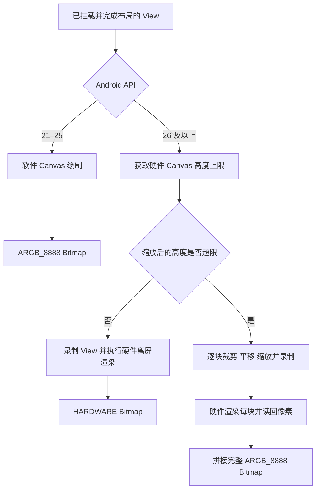

# ViewCapture：用硬件绘制捕获 Android View，保留透明度并支持长图

生成分享卡片、保存复杂布局、导出一段超出屏幕的内容，都需要把 Android View 转成 Bitmap。最常见的做法是创建 Bitmap，再调用 `view.draw(new Canvas(bitmap))`。对于文本和普通图形，这通常够用；当内容包含正在播放视频的 TextureView、硬件 Bitmap、Outline 圆角裁剪或 RenderEffect 时，截图就可能与界面显示不同。

[ViewCapture](https://github.com/android-notes/ViewCapture) 提供了一个简单的入口：

```java
Bitmap bitmap = ViewCapture.capture(contentView);
```

它在 Android 8.0 及以上通过硬件 Canvas 录制目标 View，再进行离屏渲染。截图覆盖目标已完成布局的完整范围，保留透明度；超高内容自动分块；需要控制尺寸时，可以在绘制阶段直接缩放。Android 5.0–7.1 则使用软件 Canvas。

本文结合项目实现，介绍三种截图方式的区别、ViewCapture 的绘制路径、长图处理方式，以及接入时需要注意的 Bitmap 行为。

## 一、三种截图方式，捕获的内容有什么不同

### Software Canvas：直接绘制到软件 Bitmap

典型实现只有几行：

```java
Bitmap bitmap = Bitmap.createBitmap(
        view.getWidth(), view.getHeight(), Bitmap.Config.ARGB_8888);
Canvas canvas = new Canvas(bitmap);
view.draw(canvas);
```

它以目标 View 为边界，可以保留透明度，也能绘制已经完整布局的长内容。但这里的 Canvas 是软件 Canvas，即使 Activity 开启了硬件加速，也不会改变 `new Canvas(bitmap)` 的性质。

这会影响截图与屏幕的绘制一致性。例如，TextureView 依赖硬件加速；部分通过硬件渲染节点实现的效果不能由这条软件路径重现；如果 View 内部直接把 `HARDWARE` Bitmap 画到软件 Canvas，还可能抛出异常。TextureView 的硬件加速要求见 [Android 官方文档](https://developer.android.com/reference/android/view/TextureView)。

问题不在于这几行代码写错了，而在于它选择了与界面不同的绘制路径。普通内容可以使用这种方法，但复杂内容需要检查实际输出。

### PixelCopy：复制 Surface 已经生成的像素

PixelCopy 可以从 Window、Surface 或 SurfaceView 复制像素。以 Window 为来源时，可以通过矩形截取目标 View 所在的位置，但得到的是该区域已经渲染到 Window Surface 的结果。[PixelCopy 官方文档](https://developer.android.com/reference/android/view/PixelCopy)

假设目标 LinearLayout 是透明的，带有内边距，祖先 View 绘制了一张背景图。屏幕上，背景会透过内边距显示出来。PixelCopy 复制这个区域时，背景已经参与像素合成，因此也会进入结果。

**按 View 的屏幕坐标裁剪，并不能重新得到这个 View 独立的透明图层。** 截图区域中来自同一 Window 的其他可见内容，也可能被一起复制。

长图还需要额外工作：把内容逐段滚动到可见区域，等待界面绘制，再复制、拼接，最后恢复原来的滚动位置。动态视频、网页变化和滚动时序都会影响这个过程。

PixelCopy 适合获取指定 Surface 已经显示出来的画面；它没有通用的、只接收任意 View 并导出其全部独立内容的接口。

### ViewCapture：按 View 范围进行硬件离屏绘制

ViewCapture 将两项能力放到了一起：

- 用目标 View 的绘制层级决定截图内容，保留透明区域。
- 使用硬件 Canvas，让子 View 尽量沿用硬件绘制路径。

这里的“完整内容”是目标 View 已完成布局的宽高范围。例如，截图 ScrollView 的直接子 LinearLayout，可以覆盖它的屏外部分；不需要把 ScrollView 逐段滚动。

| 维度 | Software Canvas | ViewCapture | PixelCopy |
| --- | --- | --- | --- |
| 工作方式 | View 绘制到软件 Bitmap | View 录制到硬件 Canvas，再离屏渲染 | 复制来源 Surface 的像素 |
| 截图边界 | 目标 View | 目标 View | Window 或 Surface 的指定区域 |
| 透明背景 | 可保留 | 可保留 | 取决于来源像素；已合入的背景无法剥离 |
| TextureView 视频 | 普通 `View.draw()` 路径无法保留画面 | Android 8+ 可捕获已就绪画面 | 可复制来源中已经渲染的视频画面 |
| 硬件绘制效果 | 与屏幕可能有明显差异 | 能保留更多硬件效果，仍需验证具体场景 | 保留来源 Surface 已有的绘制结果 |
| 超屏长内容 | 可绘制完整布局，需控制内存 | 自动按高度分块，不滚动界面 | 示例中通过滚动、等待和拼接完成 |
| 接入成本 | 简单内容接入直接 | 一个截图调用 | 需要处理来源、坐标、回调和长图时序 |
| 主要边界 | 软件绘制兼容性 | 隐藏 API、设备差异、内存和独立 Surface | 无法分离已合成的 View 图层 |

## 二、看看实际输出

下面三张图来自同一个测试布局，包含动态视频 TextureView、Outline 圆角渐变和 RenderEffect 模糊。目标布局透明且带有内边距，背景图绘制在祖先 View 上。

| Software Canvas | ViewCapture | PixelCopy |
| --- | --- | --- |
|  |  |  |
| 视频画面缺失，圆角裁剪和模糊未保留 | 保留视频、圆角裁剪和模糊，内边距透明 | 保留来源中的效果，同时截入祖先背景 |

这些是 Android 15 真机生成的原始 PNG，保留透明通道。视频在截图期间持续播放，所以不同方案中的帧可能不同，不应把视频帧差异当成截图错误。场景和校验信息见[截图记录](images/capture-info.json)。

ViewCapture 的价值在这种内容导出场景中尤其明确：既需要硬件绘制效果，又希望拿到能放到其他背景上的独立素材。

## 三、核心原理：先录制绘制指令，再生成像素

### RenderNode 保存的是什么

RenderNode 保存绘制指令及相关渲染属性。`beginRecording()` 返回 RecordingCanvas，调用 View 的 `draw()` 后，绘制操作被记录下来；`endRecording()` 结束录制。录制完成还不等于 Bitmap 已经生成，需要进一步执行渲染。[RenderNode 官方文档](https://developer.android.com/reference/android/graphics/RenderNode)

Android 10+ 的单次截图路径可以用下面的代码说明。它省略了库中的版本适配、分块和资源封装，`createHardwareBitmap()` 也需要项目提供的隐藏 API 编译与访问配置：

```java
RenderNode node = new RenderNode("ViewCapture");
node.setPosition(0, 0, width, height);
try {
    RecordingCanvas canvas = node.beginRecording(width, height);
    try {
        canvas.scale(scale, scale);
        view.draw(canvas);
    } finally {
        node.endRecording();
    }
    Bitmap bitmap = HardwareRenderer.createHardwareBitmap(node, width, height);
} finally {
    node.discardDisplayList();
}
```

实际实现见 [Api29CaptureNode](../lib/src/main/java/com/wanjian/capture/Api29CaptureNode.java)。与软件方案相比，变化发生在传给 `View.draw()` 的 Canvas 以及后续渲染阶段，业务不需要重新实现一套文字、图片和自定义 View 的绘制逻辑。



### 为什么可以保留透明度

这条路径只调用目标 View 的 `draw()`，不会先把祖先背景绘制进来。目标没有绘制的不透明区域可以保持透明，目标自己的背景和子 View 内容则照常参与绘制。

因此，透明度不是通过抠图或背景颜色匹配恢复的，而是在渲染过程中保留下来的。

### Android 8–9 与 Android 10+ 的适配

| Android 版本 | 录制与渲染路径 |
| --- | --- |
| 5.0–7.1，API 21–25 | 软件 Canvas |
| 8.0–9，API 26–28 | `android.view.RenderNode.start/end` 与 `ThreadedRenderer.createHardwareBitmap()` |
| 10+，API 29+ | `android.graphics.RenderNode.beginRecording/endRecording` 与 `HardwareRenderer.createHardwareBitmap()` |

库通过独立的 CaptureNode 子类隔离这些版本差异。隐藏方法由 `hidden-api-stubs` 模块提供编译时声明，`lib` 通过 `compileOnly` 依赖它；这些框架声明不会打包进运行时，由设备上的 Android 实现执行实际调用。

编译时声明只解决“能否编译”，不解除系统的隐藏 API 限制。Android 9+ 的访问配置由 HiddenApiBypass 完成，通过静态初始化执行一次。隐藏 API 不具有公开 SDK 的兼容性承诺，版本适配范围与实际设备验证范围需要分别看待，详见[验证说明](VALIDATION.md)。

## 四、超高 View 为什么需要分块

GPU 渲染目标存在尺寸限制。项目会读取硬件 Canvas 的 `getMaximumBitmapHeight()`，再与缩放后的输出高度比较。在本项目的测试设备上，上限为 16384px；这只是该设备的结果，不能作为所有设备的固定值。

当内容高于上限时，先把它录制进一个更高的 RenderNode，再渲染到同样高度的 ImageReader，并不能消除最终渲染目标的尺寸限制。把小块硬件 Bitmap 画进一个超大的硬件目标，也仍然需要这个超大目标能够被 GPU 支持。

ViewCapture 的处理方式是：每次只生成一个高度受控的硬件分块，再读回像素，拼接到完整尺寸的软件 Bitmap 中。

### 分块如何对应原始内容

分块位置以输出像素计算。对于起始位置为 `top` 的分块，核心变换为：

```java
recording.clipRect(0, 0, width, tileHeight);
recording.translate(0, -top);
recording.scale(scale, scale);
view.draw(recording);
```

先确定分块输出区域，再把完整内容向上平移，并应用缩放。原始纵坐标 `y` 对应分块中的位置为：

```text
yInTile = y × scale - top
```

这样不需要修改 View 的布局或滚动位置。最后一块不足标准高度时，只拼接有效区域。完整逻辑见 [ViewCapture](../lib/src/main/java/com/wanjian/capture/ViewCapture.java)。

裁剪限制了分块的输出范围，但不代表每个自定义 View 都会跳过范围外的全部计算。每块仍会调用 `view.draw()`，因此绘制指令复杂度和分块数量都会影响耗时。

### ImageReader 复用什么

Android 10+ 的分块路径在一次截图中创建并复用 ImageReader、HardwareRenderer 和 RenderNode：

```text
更新分块绘制指令
    → HardwareRenderer 渲染到 ImageReader 的 Surface
    → 获取 Image / HardwareBuffer
    → 包装为 HARDWARE Bitmap
    → copy 为 ARGB_8888
    → 拼接有效区域并释放本块临时资源
    → 处理下一块
```

ImageReader 负责接收渲染结果，真正把硬件像素变为 CPU 可读像素的是后续 `Bitmap.copy()`。复用这些资源可以减少逐块重复初始化；当前复用范围是一次截图内部，并非不同截图调用之间的全局缓存。实现见 [ImageReaderCaptureNode](../lib/src/main/java/com/wanjian/capture/ImageReaderCaptureNode.java)。

Android 8–9 复用对应的旧版 RenderNode，每块通过 ThreadedRenderer 创建硬件 Bitmap，再执行读回和拼接。

最终长图使用 `ARGB_8888`，因此仍需要大约 `宽 × 高 × 4` 字节保存完整像素，还要加上分块、读回等临时资源。分块解决了硬件目标的高度问题，并不意味着可以在有限内存里生成任意大的单张图；当前也没有做宽度方向分块。

## 五、scale 在绘制阶段降低输出尺寸

调用方式：

```java
Bitmap bitmap = ViewCapture.capture(contentView, 0.5f);
```

比例范围为 **(0, 1]**，宽高同比例缩放，四舍五入且至少为一个像素。`0`、负数、超过 `1` 的值以及 NaN 都不接受。

实现会先计算缩放后的输出尺寸，再决定是否分块。每次录制时都执行 Canvas 缩放，不会先生成一张完整原尺寸截图再缩小。原始 View 的布局尺寸保持不变。

对于 `ARGB_8888`，忽略取整等因素，输出像素量近似为：

```text
pixelBytes ≈ originalWidth × originalHeight × 4 × scale²
```

因此 `scale=0.5` 时，逻辑像素量约为原来的四分之一。耗时还包含 View 遍历、指令录制、渲染同步和读回等开销，不会严格按平方减少。

## 六、接入与 Bitmap 使用方式

### 添加依赖

使用仓库源码时，可以直接依赖 `lib` 模块：

```groovy
dependencies {
    implementation project(':lib')
}
```

通过 JitPack 接入时，先在 `settings.gradle` 配置仓库：

```groovy
dependencyResolutionManagement {
    repositories {
        google()
        mavenCentral()
        maven { url 'https://jitpack.io' }
    }
}
```

再添加依赖，将示例版本替换为已经在 JitPack 构建成功的标签：

```groovy
dependencies {
    implementation 'com.github.android-notes:ViewCapture:v0.1.0'
}
```

版本是否可解析，以 [JitPack 构建页面](https://jitpack.io/#android-notes/ViewCapture) 为准。发布配置见[发布说明](PUBLISHING.md)。

### 选择正确的截图目标与调用时机

目标需要已经挂载、显示并完成布局，截图在主线程调用。包含图片、视频或网页时，还要等待所需内容就绪，完成布局并不等于视频首帧已经到达。

对于 ScrollView 内的完整 LinearLayout：

```java
import android.graphics.Bitmap;
import android.view.View;
import com.wanjian.capture.ViewCapture;

View contentView = scrollView.getChildAt(0);
Bitmap bitmap = ViewCapture.capture(contentView, 0.5f);
```

这里选择的是完整内容 View。若传入 ScrollView，自身高度通常只有可见视口那么高，不能据此期待输出全部长内容。

`capture()` 是同步方法。复杂长图会占用主线程时间，宜在明确的导出操作中调用，并根据所需清晰度选择比例；不能为避免阻塞就直接把 View 绘制搬到后台线程。

### 判断返回类型

单次硬件截图返回 `HARDWARE`，分块拼接和软件回退返回 `ARGB_8888`。缩放也可能改变是否分块，所以应检查实际结果：

```java
boolean hardware = Build.VERSION.SDK_INT >= 26
        && bitmap.getConfig() == Bitmap.Config.HARDWARE;
```

软件 Bitmap 也可能不可修改，因此不能用 `isMutable() == false` 来判断是否为硬件 Bitmap。

| 操作 | HARDWARE Bitmap 的使用方式 |
| --- | --- |
| 读取宽、高、Config 等元数据 | 可以直接调用 |
| 显示到 ImageView 或通过 Canvas 绘制 | 接收它的 Canvas 需要是硬件 Canvas |
| `getPixel()`、`getPixels()`、`copyPixelsToBuffer()` | 先复制为软件 Bitmap |
| `setPixel()`、`eraseColor()`、`new Canvas(bitmap)` | 需要可修改的软件 Bitmap |
| `copy(Bitmap.Config.ARGB_8888, ...)` | 可以，用于像素读回 |
| `compress()` | 可以，但可能涉及读回和编码，宜在后台执行并检查返回值 |

具体约束见 [Bitmap 使用说明](../README.zh-CN.md#返回-bitmap-的使用注意事项)。PNG 可以保留透明度，JPEG 不保留。

需要处理像素或使用软件 Canvas 时：

```java
Bitmap editable = bitmap.copy(Bitmap.Config.ARGB_8888, true);
if (editable == null) {
    throw new IllegalStateException("Could not copy capture bitmap");
}
Canvas canvas = new Canvas(editable);
```

`true` 表示副本可修改；只读取像素时可用 `false`。如果结果已经是 `ARGB_8888`，读取无需额外复制。硬件像素读回可能阻塞，并增加一份软件像素内存，大图转换可在截图完成后交给后台处理。

Bitmap 由调用方持有。不要在设置给 ImageView 后立即 `recycle()`，应等界面绘制和后台任务不再使用它。极高的软件 Bitmap 用硬件 Canvas 整张显示时仍可能遇到尺寸限制，预览层也应按可见区域处理。

## 七、Release 实测表现

三方案测试使用 Xiaomi 24069RA21C，Android 15 / API 35，开启 R8 的 Release 包。测试日期为 2026 年 10 月 20 日。

目标是 **572 × 115728px** 的完整透明布局，包含 11 组混合内容、154 个直接子 View。每种方案预热一次，然后测量五次单次截图，每轮轮换执行顺序。

| 方案 | 平均耗时，ms | 范围，ms |
| --- | ---: | ---: |
| Software Canvas | 1511.71 | 1501.23–1533.62 |
| ViewCapture | **904.06** | 827.85–940.40 |
| PixelCopy stitching | 3481.09 | 3285.15–3577.72 |

计时终点是完整结果可由 CPU 读取，包含分配、录制、绘制、读回、拼接和方法内资源清理。PixelCopy 还包含滚动、等待绘制以及恢复位置。不包含预热、预览、编码保存或校验。

在这组长图场景中，ViewCapture 的平均耗时约比 Software Canvas 少 40.2%，比 PixelCopy stitching 少 74.0%。三者输出的绘制完整度不同，这不是完全相同像素结果之间的纯渲染速度比较，也不能直接推广到所有设备或短布局。详细方法及样本见[性能报告](BENCHMARK.md)和[原始数据](benchmarks/capture-2026-10-20.json)。

### 不同 scale 的内存与速度

另一轮独立测试使用相同设备和原始布局，每个比例同样预热一次、测量五次。以下摘取具有代表性的比例：

| scale | 输出尺寸 | 分块数 | 输出类型 | Bitmap 报告分配，MiB | API 返回平均耗时，ms | CPU 可读平均耗时，ms |
| ---: | --- | ---: | --- | ---: | ---: | ---: |
| 1 | 572 × 115728 | 8 | ARGB_8888 | 252.52 | 1356.51 | 1356.52 |
| 0.75 | 429 × 86796 | 6 | ARGB_8888 | 142.04 | 900.20 | 900.20 |
| 0.5 | 286 × 57864 | 4 | ARGB_8888 | 63.13 | 578.60 | 578.60 |
| 0.25 | 143 × 28932 | 2 | ARGB_8888 | 15.78 | 335.99 | 336.00 |
| 0.15 | 86 × 17359 | 2 | ARGB_8888 | 5.69 | 219.98 | 219.99 |
| 0.14 | 80 × 16202 | 1 | HARDWARE | 8.16 | 172.43 | 185.35 |

这一轮中，`scale=0.5` 的 Bitmap 报告分配减少了 75%，API 返回平均耗时减少约 57.3%。

`0.14` 的高度已经低于本机 16384px 上限，因此走单次硬件截图，返回类型发生变化。表中的分配来自 `getAllocationByteCount()`，不代表完整的 GPU 内存占用；这里硬件结果的报告值高于逻辑像素量，不能把它和软件 Bitmap 的报告值直接当成同一分配模型。

内存另行在独立进程中采样：`scale=1` 的观测峰值 RSS 增量为 358.48MiB，`scale=0.5` 为 122.00MiB。它们包含临时资源和场景活动，是近似采样值，不是截图的精确独占内存，也不包含独立 WebView 进程及硬件结果的额外 CPU 副本。

比例测试与上面的三方案测试来自不同轮次，应在各自轮次内比较。完整八组比例、采样口径和原始记录见[比例测试报告](SCALE_BENCHMARK.md)。

## 八、使用边界与一个 Android 8.1 细节

**SurfaceView 需要单独处理。** 它的画面位于独立 Surface 中，不能因为它是目标布局的子 View，就期待 `view.draw()` 带上其像素。需要时应单独捕获对应 Surface，再按位置合成；当前 ViewCapture 不会自动完成这一步。

**完整 View 不等于完整数据集。** ViewCapture 捕获当前已经布局的 View 层级，不会自动创建 RecyclerView 尚未绑定的条目，也不会展开 WebView 的全部网页内容。对于已经实际撑开的 LinearLayout，可以截取完整高度；虚拟化内容需要另行组织导出布局。

**硬件效果仍取决于绘制层级。** 示例中的圆角和 RenderEffect 位于目标内部的子 View。直接调用目标 `draw()` 不等于完整重现父级绘制该目标时施加的一切属性。目标自身的 elevation 阴影通常由父级绘制过程参与生成，还受边界裁剪和离屏光照配置影响，不能承诺截图与屏幕阴影完全一致。

**动态长图不保证同一时刻。** 分块依次渲染，视频和网页可能在块间变化。如果业务需要一致的静态状态，应在截图前协调内容更新。

此外，Android 8.1 的旧渲染接口存在一个容易忽略的预乘标记问题：渲染得到的像素已经预乘，但构造 Java Bitmap 时遗漏了相应请求标记，后续 `Bitmap.copy()` 会继承这个标记，导致软件副本被 Canvas 拒绝，并出现 `trying to use a non-premultiplied bitmap`。

ViewCapture 在返回或读回前统一设置正确的预乘标记，保留透明度，不重新修改像素颜色。这个处理针对渲染器已知输出，不能照搬为任意非预乘图片的通用修复方式。源码依据和实现说明见[原理文档](METHODOLOGY.md#bitmap-ownership)。

## 九、适合怎样使用 ViewCapture

当目标是导出一个包含硬件绘制内容的独立 View，尤其需要透明背景、屏外长内容或按比例输出时，ViewCapture 可以把接入收敛为一个调用。选择合适的截图范围与 scale，再根据返回的 Bitmap 类型进行显示、像素处理或编码即可。

项目地址：[android-notes/ViewCapture](https://github.com/android-notes/ViewCapture)。仓库包含库模块、并排对照示例、真实截图和可复核的测试数据，可用自己的复杂 View 直接验证输出。
